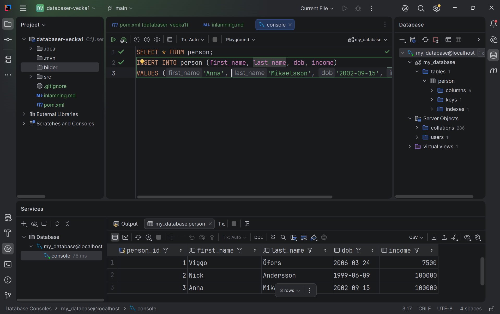
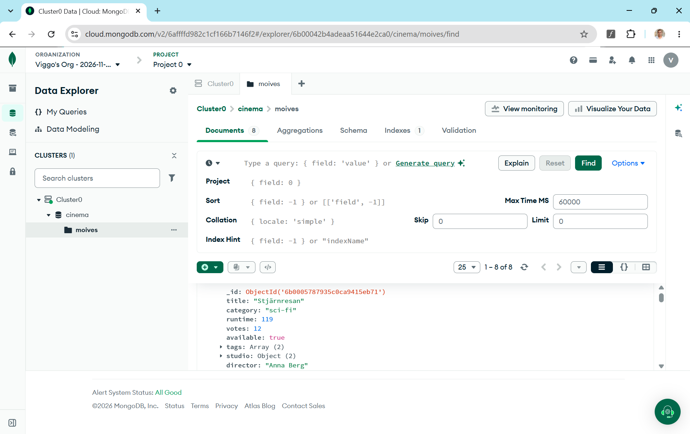
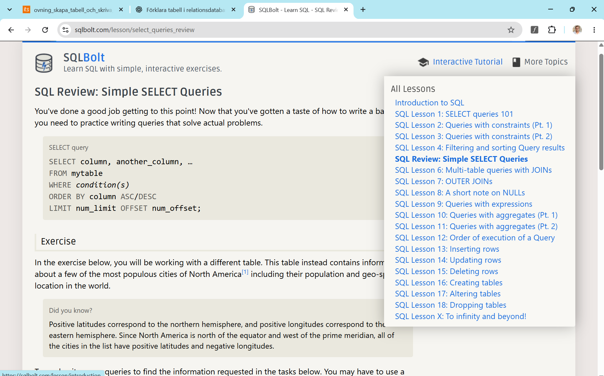

# Labb 1

# MySQL

Skärmdump som visar database explorer i IntelliJ med skapad person-tabell med data:



NOT: Ni ska även ha skapat en user som bara har access till databasen my_database, ingen bild krävs

# MongoDB

Skärmdump av databas på MongoDB Atlas med skapad movie-collection med data:



# SQL

Skärmdump som visar att ni klarat av första två sidorna på sqlbolt.com:s interaktiva tutorial



# Frågor som ni ska svara på (G-nivå)

Besvara frågorna med egna ord. Ge gärna exempel.

## Databaser och verktyg

1. Vad är en databas, och vad kan den användas till? - En databas är en plats där man sparar aktuell data från t.ex. ett
   program, även efter programmet är avstängt. Det gör det möjligt att gå in på ett program från en annan enhet, och
   informationen finns kvar. Ett exempel är ett bank konto, som behöver spara aktuell data och information eller ett
   spel som sparar highscores.
2. Vad används språket SQL till? - SQL används för CRUD i relationsdatabaser som är byggda av tabeller.

## Tabeller och relationer

3. Vad är en tabell, en rad och en kolumn? - Själva tabellen innehåller rader och kolumner, där varje rad t.ex.
   motsvarar en användare, eller en person, där varje kolumn innebär datan som t.ex. personen har, t.ex "Person" ->
   Data (
   namn, efternamn, ålder), där 'namn', 'efternamn' och 'ålder' är kolumner, och hela personen motsvarar en rad.
4. Vad är en primärnyckel, och varför behövs den? - En primärnyckel används för att identifiera varje rad. Om vi har två
   personer med samma namn i en tabell, och vi har ett unikt id, som är en primärnyckel, så kan vi vara säkra på vilken
   som är vilken.
5. Vad är en främmande nyckel? - En främmande nyckel är en kolumn i en tabell som kan användas för att koppla ihop den
   med en annan tabell, t.ex. om vi har en person med ett id (primärnyckel), och vi har en annan tabell med olika
   bankkonton. Om vi då har en kolumn 'person_id', så kan vi koppla den till personens id, och då har vi koll på vem
   bankkontot ägs av.
6. Varför är det bra att lagra kunduppgifter och köp i olika tabeller? - Det är bra att lagra kunduppgifter och köp i
   olika tabeller eftersom det skapar bättre struktur och gör det lättare att hantera data. En kund kan göra flera köp,
   och då kan det vara bra att köpen kopplas till samma kund med hjälp av en foreign key.

## NoSQL

7. Vad menas med NoSQL, och hur kan information organiseras i en sådan databas? - NoSQL är "Not-Only SQL", och
   organiserar information i t.ex. dokument. I en dokument baserad databas kan information sparas i JSON liknande
   format. T.ex. så här:

```JSON
{
  "first_name": "Viggo",
  "last_name": "Öfors"
}
```

8. Ge ett exempel på när en NoSQL-databas kan vara lämplig och förklara varför. - NoSQL-databaser kan vara lämpligt när
   man har ostrukturerad data. Ett exempel är en Webbshop där olika produkter kan ha olika information. NoSQL-databas,
   såsom MongoDB, tillåter ett dokument att ha olika fält, till skillnad från SQL, där alla rader har samma kolumner.
   NoSQL är alltså flexibelt och även snabbt.

## SQL – hämta data från tabellen person

Skriv en SQL-fråga som svar på varje uppgift.

9. Hämta alla kolumner för alla personer i tabellen.

```SQL
SELECT *
FROM person;
```

10. Hämta endast förnamn och efternamn för alla personer.

```SQL
SELECT first_name, last_name
FROM person;
```

11. Hämta förnamn, efternamn och inkomst för personer med en inkomst över 30 000.

```SQL
SELECT first_name, last_name, income
FROM person
WHERE income > 30000;
```

12. Hämta alla personer födda före den 1 januari 1990.

```SQL
SELECT *
FROM person
WHERE dob < '1999-01-01';
```

13. Hämta förnamn, efternamn och inkomst, sorterat efter inkomst från högst till lägst.

```SQL
SELECT first_name, last_name, income
FROM person
ORDER BY income DESC;
```

14. Räkna hur många personer som finns i tabellen.

```SQL
SELECT COUNT(*)
FROM person;
```

# VG-nivå

Dessa frågor ska besvaras med ett längre svar, minst en halv A4-sida:

1. En banköverföring avbryts efter att pengarna dragits från det första kontot.
   Vad kan konsekvensen bli, och hur kan en transaktion hjälpa? -
   Om en banköverföring avbryts efter att pengarna dragits från kontot kan resultatet bli fruktansvärt. Pengarna kan
   försvinna för personen och aldrig nå en slutdestination, vilket innebär att pengarna bara försvinner ut i luften. En
   transaktion kan hjälpa genom att antingen stega igenom alla steg i överföringen, eller att avbryta och återställa
   alltihop med hjälp av "ROLLBACK", vilket då innebär att pengarna inte kommer dras från personens konto.

   När man har startat en transaktion genomför den alla steg. Om allting går bra, kör programmet "COMMIT", annars körs "
   ROLLBACK". Det här är A:et i ACID, vilket är Atomicity, som betyder att bankkontot som pengarna dras från, och kontot
   som pengarna hamnar på, sparas tillsammans, eller ångras tillsammans.

   Exempel:
   Om Alfred har 5000kr på sitt konto, och ska föra över 1000kr till Niklas, men något går fel och pengarna dras från
   Alfreds konto, men hamnar inte på Niklas konto, då hade en transaktion varit bra att använda sig av. Med hjälp av
   transaktionen kan båda ändringarna genomföras samtidigt, och om något går fel används ROLLBACK, så att Alfreds pengar
   inte dras från kontot.

2. Välj ett enkelt system, antingen en webbutik eller en chatt.
   Resonera om när en relationsdatabas respektive en NoSQL-databas
   kan vara lämplig. Motivera med hur informationen ska lagras och användas. -
   En webbshop är ett bra exempel på ett enkelt system där man kan välja antingen en NoSQL-databas, eller en
   SQL-databas.
   En NoSQL-databas kan vara bra eftersom det tillåter att man lagrar ostrukturerad data. Produkterna kan ha olika
   egenskaper, och vissa egenskaper som är den samma, t.ex:

- Produkt namn
- Beskrivning
- Pris

  Men vissa produkter kanske har olika färger, storlekar, material, osv. Då blir det lättare att strukturera det i en
  NoSQL-databas, som MongoDB. Det blir även lättare att lägga till flera nya egenskaper när man skapar nya produkter.
  Det hade också varit möjligt att använda en SQL-databas för en webbshop. Man kan sätta kolumner
  som behövs (t.ex. Produkt namn, Beskrivning, Pris), till "NOT NULL", och låta de andra kolumnerna tillåta att man inte
  sätter något värde, men det blir jobbigt att lägga till nya egenskaper senare.

  Men en SQL-databas hade faktiskt kunnat vara bättre i vissa fall. Det är bra när man hanterar kunder och
  beställningar, så
  att man kan länka beställning(arna) till kunden med hjälp av primära och främmande nycklar. Det är även bra för
  transaktioner vid betalningar för att undvika att något går fel. Och till sist, även att data är strukturerad.

  Om webbshoppen hade många kunder och beställningar, skulle jag välja en SQL databas. Men om webbshoppen har många
  olika produkter med olika egenskaper skulle jag välja NoSQL-databas, eftersom den är mer flexibel när det gäller hur
  informationen lagras.

